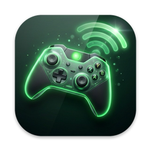
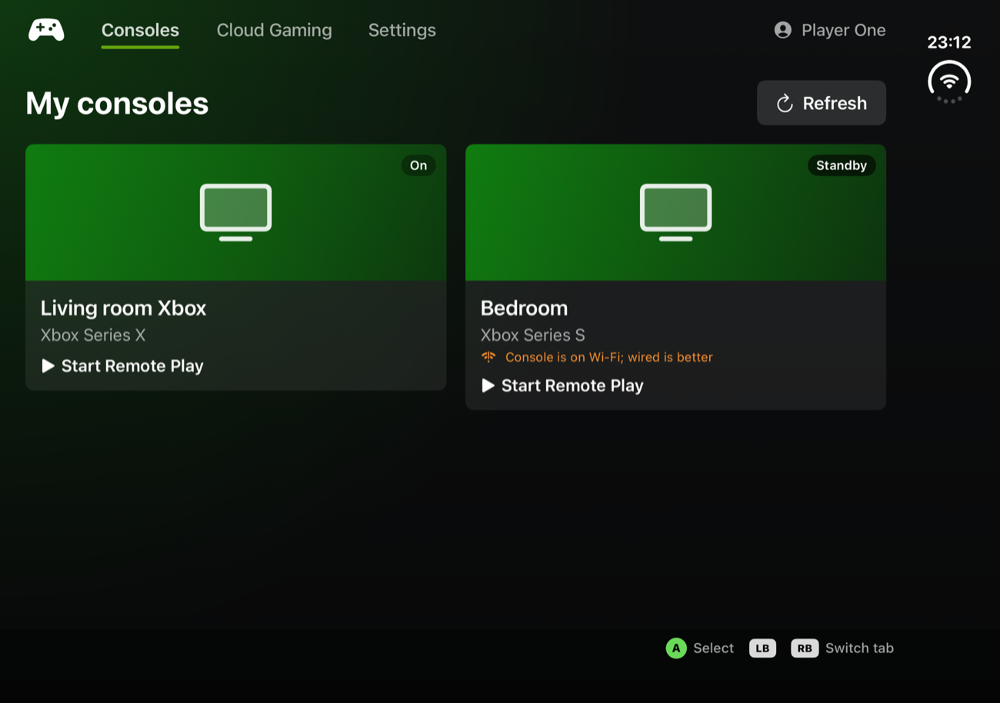
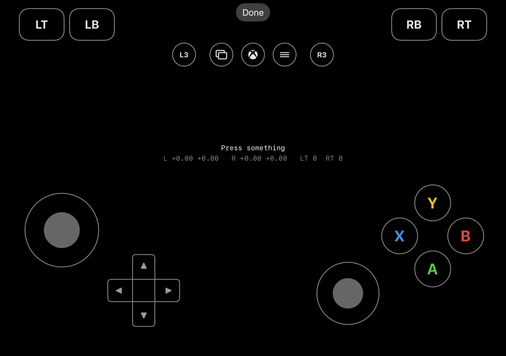

<div align="center">



# iGreenLight

### Your Xbox, on your Mac, iPhone and iPad. Native. No browser, no Electron.

Xbox Remote Play and Xbox Cloud Gaming in a real Apple app: Swift, Metal and MetalFX from the first frame to the last.

[](https://github.com/andreencar/iGreenLight/releases/latest)
[](https://github.com/andreencar/iGreenLight/releases)
[](https://github.com/andreencar/iGreenLight/actions/workflows/ci.yml)
[](LICENSE)

[](https://github.com/andreencar/iGreenLight/stargazers)

[**Get it on iPhone or iPad**](#installing-on-iphone-or-ipad) · [**Build it for Mac**](#on-the-mac) · [Features](#everything-it-does) · [Setup and reference](docs/SETUP.md) · [Contributing](#contributing)

<br>



</div>

> [!WARNING]
> **Unofficial, use at your own risk.** iGreenLight is not affiliated with, endorsed by or supported by Microsoft or
> Xbox. Like Greenlight, it signs in with the client ID of Microsoft's own Xbox app and talks to the streaming service
> the way the Xbox web client does. Microsoft may block this at any time, and using an unofficial client may be against
> the terms of your account.

## Why iGreenLight

Streaming an Xbox to an Apple device usually means a browser tab, or a web page wrapped up as an app. iGreenLight is
neither. It is written for Apple hardware and uses what that hardware is good at.

| | |
|---|---|
| 🖥️ **Truly native** | Swift and SwiftUI, Metal rendering, VideoToolbox decoding, the GameController framework. No Electron and no web view anywhere in the stream. |
| 🎮 **Remote Play at up to 1440p** | Ask your console for 720p, 1080p or 1440p, and the app asks again when the console drifts back down. |
| ☁️ **Cloud Gaming built in** | Your Game Pass library with box art, queue and wait times, and the same picture pipeline as Remote Play. |
| ✨ **A picture pipeline of its own** | MetalFX Spatial upscaling, Apple's ML super-resolution, debanding, adaptive sharpening and a 10-bit path between every pass. |
| 📱 **Made for the phone too** | A full on-screen gamepad with haptics, ambient glow in the letterbox bars, and a console-style interface you can drive entirely with a controller. |
| 🔬 **Built to be measured** | A stats overlay with frame pacing, freezes and render cost, plus a diagnostics recorder that captures a whole session for you to study. |

## Everything it does

### 🎨 Picture

- **MetalFX Spatial upscaling** to your display's real resolution, on every frame.
- **VideoToolbox ML super-resolution**: Apple's low-latency model takes a 720p stream to 1080p before MetalFX finishes the job.
- **10-bit between the render passes**, so 8-bit video isn't rounded twice and gradients band less.
- **Sharper colour edges**: colour is rebuilt along brightness edges, so red text and saturated outlines don't smear.
- **Debanding** for skies, fog and dark fades, and **contrast-adaptive sharpening** with a 0–10 setting that backs off by itself when the stream is heavily compressed.
- **HDR highlight expansion** on displays with headroom, and **ambient bars** that fill the letterbox with a soft glow in the colours of the picture's edge.
- Fit, zoom or stretch, and an experimental 16:10 request.

### ⚡ Responsiveness

- **Frames are drawn the moment they are decoded**, not at the display's next tick.
- **Fast freeze recovery**: a stalled picture asks for a fresh keyframe after about a quarter of a second.
- **Optional smooth frame pacing** for an even rhythm in steady camera movement.
- **Experimental frame generation** for 30 fps games: Apple's ML frame interpolation fills in pictures for up to 60 fps (or 40 on a 120 Hz display), only while the game runs below that, at a cost of about 25 ms of latency.
- **Protect frame rate**: the upscaler steps down by itself when the device runs hot, and back up when it has cooled.
- **Mac on Wi-Fi**: AirDrop's radio hopping (AWDL) is kept off while you play, because it shows up as latency spikes.

### 🎮 Input

- **Up to four controllers**, with rumble.
- **On-screen gamepad** on iPhone and iPad whenever no controller is connected, with Taptic Engine feedback.
- **Mouse and keyboard, as themselves**, for games that support them, or the **mouse as the right stick** for games that don't.
- **Keyboard as a gamepad** when a controller isn't to hand.
- **Controller paired to the console?** The app can be just the screen.

### 🧭 The app around the game

- A **console-style interface**: D-pad to move, A to select, LB and RB to switch tabs. The same on Mac, iPhone and iPad.
- **Stereo 48 kHz game audio** through an output of its own; on the Mac it follows your AirPods when you connect them mid-game.
- **Stats overlay** during play, and an opt-in **diagnostics recorder** for when you want to know exactly what the stream did.

<div align="center">



*The on-screen gamepad, for when the controller is in another room.*

</div>

## New in 0.4.0

Remote Play away from home. The app now tells the console its public address and sends its connection details the
way the official client does, so a stream can start over mobile data or someone else's Wi-Fi, where earlier
versions never connected. New in [0.4.0](https://github.com/andreencar/iGreenLight/releases/latest) too: a request
that loses its connection while the session starts is sent once more instead of ending the attempt.

> [!NOTE]
> Some networks, mobile carriers above all, give every connection a different public address (symmetric NAT). There
> the console can only be reached if your router forwards UDP port 9002 to it; the app now says so when that is why a
> connection failed.

## Get it

### Installing on iPhone or iPad

The release `.ipa` is **unsigned**, so nothing in it is tied to anyone's Apple account. It will not install by
itself: a sideloading tool signs it with *your* Apple ID and puts it on your device.

1. Download `iGreenLight-<version>-unsigned.ipa` from [Releases](https://github.com/andreencar/iGreenLight/releases).
   `SHA256SUMS.txt` next to it lets you check the download.
2. Install it with a sideloading tool such as [AltStore](https://altstore.io), [SideStore](https://sidestore.io) or
   [Sideloadly](https://sideloadly.io), signing in with your Apple ID when it asks.
3. On the device, trust your developer certificate if iOS asks (Settings → General → VPN & Device Management).

With a free Apple ID an app installed this way stops opening after 7 days until the tool refreshes it; a paid
developer account lasts a year. These tools are independent projects, not part of iGreenLight.

Requires iOS 18 or later.

### On the Mac

There is no Mac download yet: build it from source, which takes one command on an Apple silicon Mac with Xcode 26 or later.

```bash
xcodebuild -project iGreenLight.xcodeproj -scheme iGreenLight -configuration Debug -derivedDataPath build build
```

```bash
open build/Build/Products/Debug/iGreenLight.app
```

Requires macOS 15 or later. Building for your own iPhone, signing, tests and everything else is in
[**Setup and reference**](docs/SETUP.md).

## Questions

<details>
<summary><b>Do I need Game Pass?</b></summary>

Not for Remote Play: that streams your own console and the games on it. Cloud Gaming needs whatever subscription
Microsoft requires for it.
</details>

<details>
<summary><b>What do I need on the Xbox side?</b></summary>

A console with remote features turned on (Settings → Devices & connections → Remote features), signed in with the
same Microsoft account you use in the app.
</details>

<details>
<summary><b>Is my Microsoft password seen by the app?</b></summary>

No. You sign in on Microsoft's own page; the app only receives tokens, which it keeps in the Keychain.
</details>

<details>
<summary><b>Does it support HDR?</b></summary>

The streams are SDR. On a display with HDR headroom the app can expand highlights into it (Settings → HDR highlight
expansion), which is an enhancement of the SDR picture, not true HDR.
</details>

<details>
<summary><b>Why is the iPhone app not on the App Store?</b></summary>

It is an unofficial client, so it is distributed as an unsigned `.ipa` that you sign yourself.
</details>

<details>
<summary><b>Something looks or feels wrong. What now?</b></summary>

Turn on the stats overlay, and if you can, Settings → Experimental: Diagnostics, then open an
[issue](https://github.com/andreencar/iGreenLight/issues). The log holds your console's name and IP addresses, so
look it over before attaching it.
</details>

## Standing on shoulders

iGreenLight is a port of **[Greenlight](https://github.com/unknownskl/greenlight)** by UnknownSKL (Jim Kroon), MIT
licensed. The protocol knowledge (auth flow, session API, data channel messages, input report format) comes from
Greenlight and its auth library [xal-node](https://github.com/unknownskl/xal-node). Ideas from
[Better xCloud](https://github.com/redphx/better-xcloud) were also used: the quality profiles chosen by the
device-info OS name, and the console address used as an ICE candidate. Transport is Google's
[WebRTC](https://webrtc.org). Thank you to all of them.

## Contributing

Bug reports and pull requests are welcome; start with [CONTRIBUTING.md](CONTRIBUTING.md) and the
[setup and reference](docs/SETUP.md) guide. Everyone taking part is expected to follow the
[code of conduct](CODE_OF_CONDUCT.md). Please report security problems privately, as described in
[SECURITY.md](SECURITY.md).

If iGreenLight made your evening better, a ⭐ helps other people find it.

## Licence

iGreenLight is released under the [MIT licence](LICENSE). It builds on [Greenlight](https://github.com/unknownskl/greenlight)
(MIT) and links [WebRTC](https://webrtc.org) (BSD 3-clause); their licence texts, and those of the libraries inside
the WebRTC binary, are in [`Licenses/`](Licenses), ship inside the app and are shown under Settings → About.

Not affiliated with, endorsed by or supported by Microsoft or Xbox. Xbox is a trademark of Microsoft.
